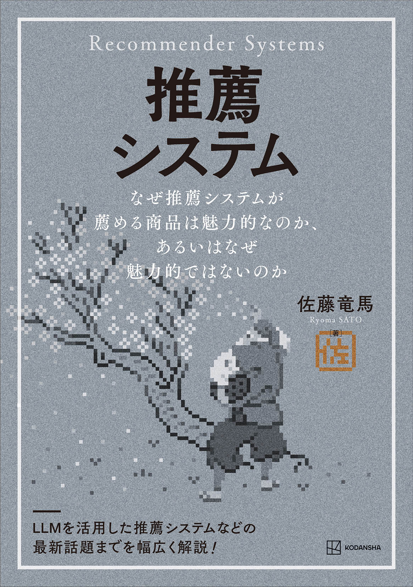

  

書籍『[推薦システム](https://www.amazon.co.jp/dp/406544750X/)』のサポートページです。

# 目次

第1章 はじめに
1.1 推薦システムとは
1.2 探索と活用
1.3 本書の特徴
1.4 本書で扱うトピック
1.5 用語の整理

第2章 推薦システムの概要
2.1 推薦システムの意義
2.2 検索システムと推薦システム
2.3 推薦システムの問題設定
2.4 内容フィルタリングと協調フィルタリング
2.5 さまざまな情報の統合
2.6 推薦システムの評価
2.7 探索と活用

第3章 内容フィルタリング
3.1 内容フィルタリングの問題設定
3.2 内容フィルタリングを用いたアイテム間推薦
3.3 内容フィルタリングを用いたユーザー向け推薦
3.4 類似度をもとにした内容フィルタリング
3.5 推薦の解釈性
3.6 機械学習モデルを用いた内容フィルタリング

第4章 協調フィルタリング
4.1 協調フィルタリングの問題設定
4.2 協調フィルタリングを用いたアイテム間推薦
4.3 近傍ベースの手法によるユーザーへの推薦
4.4 モデルベースの協調フィルタリング
4.5 内容フィルタリングと協調フィルタリングの比較

第5章 多様な情報を使った推薦
5.1 因子分解マシン
5.2 ニューラルネットワークを用いた推薦
5.3 探索を促すための特徴量設計
5.4 マッチングとリランキングの二段階構成
5.5 グラフを用いた推薦
5.6 深層学習を用いた手法は本当に優れているのか
5.7 推薦システムと検索システムの統合
5.8 大規模言語モデルを用いた推薦

第6章 評価手法
6.1 オフライン評価
6.2 オンライン評価
6.3 A/Bテストと交互編成の比較

第7章 オンライン学習
7.1 オフライン学習とオンライン学習
7.2 専門家問題と多腕バンディット問題
7.3 実現可能な場合の専門家問題のアルゴリズム
7.4 一般の場合の専門家問題のアルゴリズム（ヘッジアルゴリズム）
7.5 敵対的バンディット問題のアルゴリズム（Exp3アルゴリズム）
7.6 確率的バンディット問題のアルゴリズム（UCBアルゴリズム）
7.7 トンプソンサンプリング
7.8 文脈付きバンディット問題のアルゴリズム（LinUCBアルゴリズム）
7.9 報酬が非同期で到着する場合
7.10 複数の選択肢を同時に選ぶ場合
7.11 報酬の設計
7.12 バンディットアルゴリズムのオフライン評価
7.13 バンディットアルゴリズムを用いた推薦システムの評価

第8章 発展的な話題
8.1 クリックベイト
8.2 セレンディピティ
8.3 フィルターバブル
8.4 多様性
8.5 データのプライバシー
8.6 公平性
8.7 マイナーなクリエイターへの配慮
8.8 フィードバックループ
8.9 長期目標
8.10 サービスとユーザーの目標の不一致
8.11 ユーザーサイドの推薦システム

第9章 おわりに

# 正誤表

本書の正誤情報は[正誤表](https://github.com/joisino/recbook/blob/main/errata.md)にて公開しています。